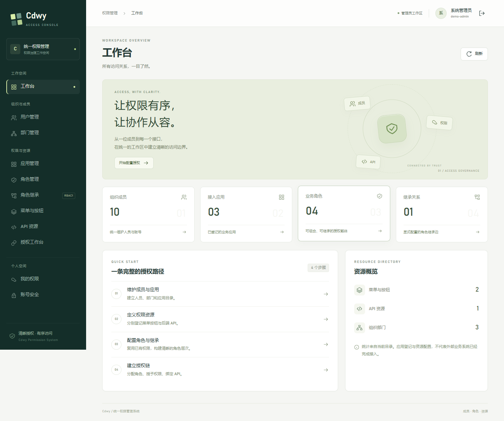
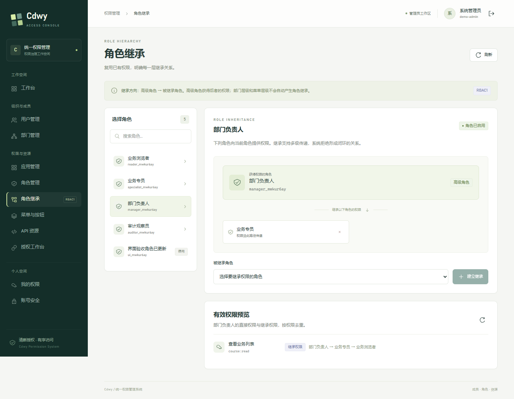
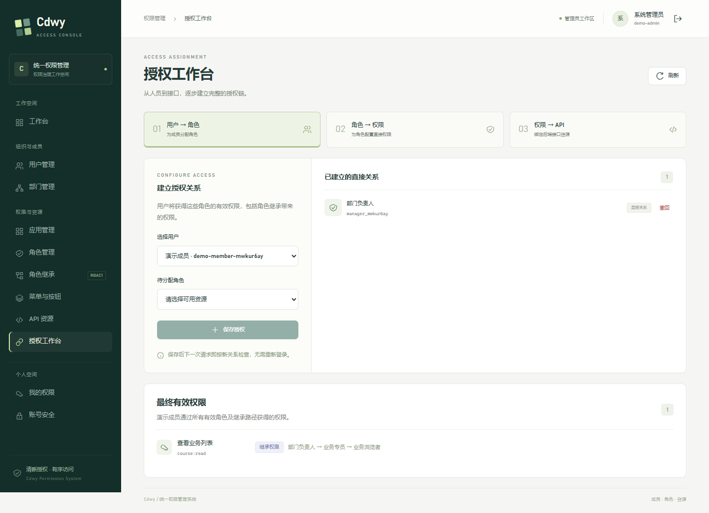
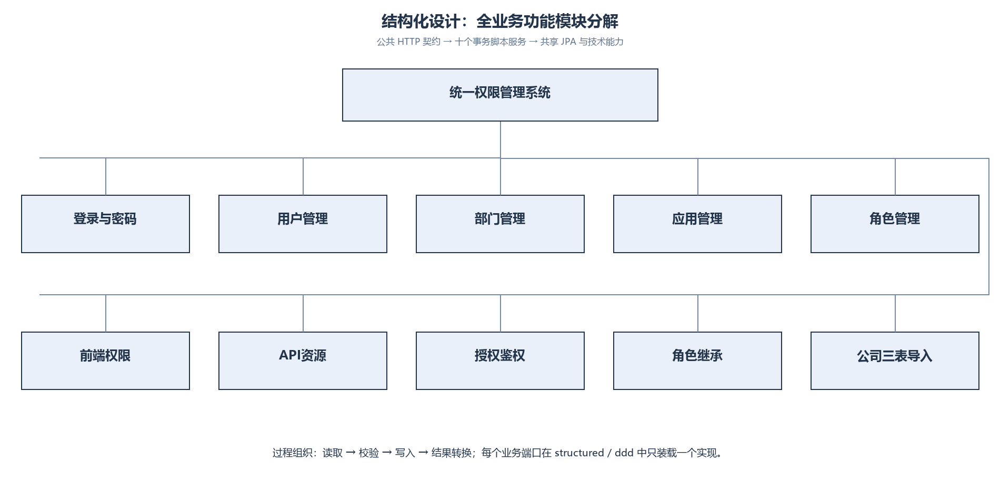
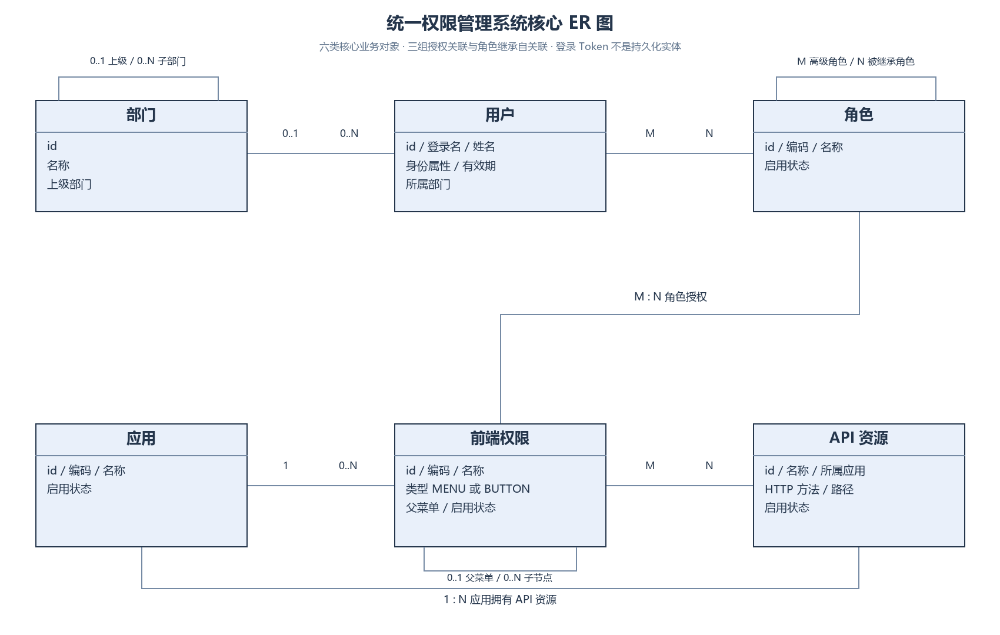

# Cdwy · 统一权限管理系统

**面向对象分析与设计课程项目｜RBAC1｜结构化与面向对象双实现**

围绕“谁通过什么角色获得哪些菜单、按钮和 API 访问权”，建立一条可配置、可解释、可撤回的授权链。当前版本提供统一管理前端、JWT 登录、十组业务用例的两种后端实现，以及公司三张 Excel 表的预览与确认导入。

小组：**Cdwy**

成员：温家正、姚景云、杜奕含、陈浩贤

[快速运行](#快速运行) · [双设计对照](#结构化与面向对象双设计) · [设计图](docs/design/README.md) · [API](docs/first-review/api-design.md) · [数据库](docs/first-review/database-design.md) · [组员阅读指南](docs/team-guide.md)



## 组员先看什么

| 想了解的内容 | 入口 |
|---|---|
| 这一版完成了什么、如何检查 | [组员阅读指南](docs/team-guide.md) |
| 两种设计如何对应，哪些能力共用 | [全业务双设计说明](docs/phase-two/full-dual-design.md) |
| 下载后直接打开图文说明、展开关键源码 | [离线阅读说明](docs/review/README.md) |
| 需求与业务边界 | [产品范围](PRODUCT.md)、[需求追踪](docs/first-review/requirements.md) |
| 模块、层次、事务及 CloneFactory | [代码架构](docs/first-review/architecture.md) |
| 所有图及可编辑、可生成的来源 | [设计图索引](docs/design/README.md)、[生成脚本](scripts/build-review-diagrams.py) |
| 接口为什么设计、对应哪些资源 | [API 设计](docs/first-review/api-design.md)、[OpenAPI JSON](docs/first-review/openapi.json) |
| 实体、关系、字段和约束 | [数据库设计](docs/first-review/database-design.md)、[MySQL DDL](docs/first-review/database-mysql.sql) |
| 验收方法与覆盖率 | [验证记录](docs/first-review/testing.md)、[机器可读汇总](docs/first-review/verification.json) |

GitHub 可直接阅读 Markdown、Java 和 PNG/SVG。HTML 阅读页需要下载整个仓库后用浏览器打开；仓库中的 HTML 文件不是已经部署的在线应用。

## 当前版本

| 项目 | 当前范围 |
|---|---|
| 业务用例 | 登录与本人改密、用户、部门、应用、角色、菜单按钮、API 资源、授权鉴权、继承维护、公司导入，共十组 |
| 权限模型 | RBAC1，多级和多继承；直接权限与继承权限取并集；显示权限来源及有效继承路径 |
| 设计实现 | 十组业务用例和角色图算法均提供 `structured` / `ddd` 实现，启动时二选一 |
| Service | 24 个 `@Service` 定义；每种模式实际装载 13 个；不将基础设施 Adapter 混入数量 |
| 持久化 | 六类核心概念、10 个 JPA Entity、11 张表、14 个外键 |
| HTTP API | 56 个实际操作；OpenAPI 与 MVC 路由逐项核对 |
| 界面 | Vue 管理工作台、独立个人空间、桌面与窄屏导航 |
| 运行方式 | 默认 H2 内存演示；另提供 H2 文件库方式；MySQL DDL 与 `validate` 配置 |

## 主要功能

- **身份与账号**：JWT Bearer 登录、BCrypt 密码、本人改密、正式/外部/临时人员有效期、账号启停与独立密码设置。
- **组织与资源**：部门树、应用、角色、菜单树、按钮，以及独立的 API 方法和路径资源。
- **三组授权关系**：用户→角色、角色→前端权限、前端权限→API，分别配置、查询和撤回。
- **RBAC1 继承**：高级角色继承低级角色权限，支持多级、多继承；拒绝自继承和循环继承，重复建立幂等。
- **可解释授权**：展示直接和继承来源，并保留有效继承路径；导航祖先容器不自动取得接口权限。
- **动态鉴权**：JWT 不存角色或权限快照；下次请求读取当前有效授权。撤掉一个来源后，其他有效来源仍可保留访问权。
- **三表导入**：预览与摘要确认、事务提交、来源字段保留、重复导入幂等、模板缩减时撤回对应授权。
- **交互反馈**：搜索与筛选、用户后端分页、加载/空状态/错误反馈、危险操作确认与个人权限验证。

管理员负责系统配置，业务访问仍需满足授权规则。改密和账号状态变化通过凭证版本使旧 Token 失效；退出清除当前标签页 Token，当前版本没有单 Token 撤销表。

### 界面预览

| 角色继承 | 授权工作台 |
|---|---|
|  |  |

界面截图和浏览器回归使用合成演示数据。更多页面见[图与截图](docs/design/README.md)。

## 结构化与面向对象双设计

两种模式使用同一套前端、Controller、用例接口、HTTP 契约和物理数据库。选择发生在 Spring 启动装配时，通过 `app.backend-strategy=structured|ddd` 指定；页面展示实际装配结果。

| 对照项 | 结构化设计 `structured` | 面向对象设计 `ddd` |
|---|---|---|
| 主要组织方式 | 按功能分解，Service 用事务脚本组织业务步骤 | 应用服务协调，领域对象维护规则和状态 |
| 用户管理入口 | `service/user/UserService` | `service/ddd/application/user/DddUserService` |
| 数据访问 | Service 直接依赖 Spring Data Repository | 应用服务依赖领域仓储端口，由 JPA Adapter 实现 |
| 核心规则 | 服务过程中的校验与更新 | `Account`、`DepartmentNode`、`FrontendPermission`、`RoleGraph` 等对象承担 |
| 通用端口 | `service/port/**` | `service/port/**` |
| 共用技术能力 | JWT、BCrypt、路径匹配、XLSX 格式解析、数据库与前端 | 同左 |

结构化调用链：`Controller → UseCase → Structured Service → JPA Repository → 数据库`。

面向对象调用链：`Controller → UseCase → DDD Application Service → Domain / Repository Port → JPA Adapter → JPA Repository → 数据库`。




十组业务的端口和两种实现逐一对应，见[完整对照表](docs/phase-two/full-dual-design.md#3-十个业务模块逐项对照)。两种模式都执行同一组核心业务验收，架构测试检查 DDD 应用/领域不依赖 JPA 实体与持久化实现。

设计组织参考了老师的[课程管理项目](https://gitee.com/mingqcn/course-project-mgt/)中用例端口、条件装配及仓储适配方式，并按统一权限管理的模型实现。

## RBAC1 与数据模型

授权链为：**用户 → 分配角色 → 角色及其继承角色 → 菜单/按钮 → API 方法与路径**。

角色继承是同一应用内的有向无环图。有效权限取并集并去重；来源与路径单独保留，便于回答“这个用户为什么能访问”。拒绝自己继承自己和间接成环；被停用或无效的角色、权限、应用和账号不会形成有效访问链。



概念 ER 表示业务实体和联系；物理模型包含用户资料与账号凭证拆表、三组授权关联表和角色继承表。完整字段、唯一键和外键见[数据库设计](docs/first-review/database-design.md)与[十一表物理 ER](docs/design/images/er-physical.png)。

## 技术栈

| 层次 | 技术 |
|---|---|
| 后端 | Java 21、Spring Boot 4.0.8、Spring MVC、Bean Validation |
| 认证 | Spring Security 密码编码、JJWT、BCrypt |
| 持久化 | Spring Data JPA、Hibernate、H2；MySQL Connector/J |
| 对象映射 | Lombok、CloneFactory 注解处理器；[依赖源码](third-party/clonefactory)随仓库提供 |
| 前端 | Vue 3、TypeScript、Vite 7、Tailwind CSS 4 |
| 验证 | Spring Boot HTTP 集成验收、JUnit、JaCoCo、Edge / Playwright |
| 文档与图 | Markdown、OpenAPI JSON、Python 生成 PNG + SVG |

## 快速运行

### 1. 获取代码并准备环境

```powershell
git clone https://github.com/yyyjjjj949/ooad.git
cd ooad
```

需要 **JDK 21**、**Maven 3.9** 和 **Node.js 20.19+ 或 22.12+**。前端依赖使用 `package-lock.json` 锁定。仓库带有 Maven Wrapper，未配置 Maven 命令时构建脚本使用 `mvnw.cmd`。

```powershell
# 替换成自己电脑上实际的 JDK 21 安装目录
$env:JAVA_HOME = 'D:\Java\jdk-21'
& "$env:JAVA_HOME\bin\java.exe" --version
```

### 2. 构建前后端并运行测试

```powershell
.\scripts\build-first-review.ps1
```

脚本先安装仓库附带的 CloneFactory 依赖，再构建 Vue 前端，最后执行后端 `clean verify`。前端产物放入 `src/main/resources/static/ui`，由同一 Spring Boot 应用提供。

默认 Maven/npm 缓存在 `D:\CodexData\cache`。需要换位置时，可显式传 `-MavenCache` 和 `-NpmCache`；例如组员没有 D 盘时：

```powershell
.\scripts\build-first-review.ps1 `
  -MavenCache (Join-Path $PWD '.cache\m2') `
  -NpmCache (Join-Path $PWD '.cache\npm')
```

### 3. 启动并打开管理界面

```powershell
.\scripts\start-first-review.ps1 -AdminUsername admin -Port 18081
```

按终端提示设置本次管理员密码，然后打开 **http://127.0.0.1:18081/ui/index.html**，使用 `admin` 与刚设置的密码登录。保持终端开启，按 `Ctrl+C` 停止。没有统一公共初始密码。

默认是 H2 内存演示，应用停止后演示数据清空；每位组员启动自己的实例，`127.0.0.1` 指向各自电脑。

### 4. 切换到面向对象模式

停止当前演示实例，设置模式后重新启动：

```powershell
$env:PERMISSION_BACKEND_STRATEGY = 'ddd'
.\scripts\start-first-review.ps1 -AdminUsername admin -Port 18081
```

改为 `structured` 即使用结构化模式。管理员登录后查看页头模式，或携带 Token 请求 `GET /api/system-info`，核对 `backendStrategy`、`authorizationModel` 及十组业务的 `modules`。

### 5. 可选：保留演示数据

```powershell
.\scripts\start-company-console.ps1 `
  -Strategy ddd -Port 18083 -RuntimeDirectory .\work\company-runtime
```

脚本首次创建 H2 文件库和随机管理员凭据，随后使用 `validate`，不会重建已有库。管理员凭据文件位置由脚本提示。切换到 `structured` 时复用同一个 `RuntimeDirectory`，先停止原实例；同一文件库不能并发由两个实例打开。

完整操作闭环、Postman 验证和浏览器回归环境变量见[运行与演示步骤](docs/first-review/demo.md)。

## 公司 Excel 导入

管理员在“数据导入”中选择员工、部门、应用软件功能权限三张表：**选择文件 → 预览与校验 → 核对摘要 → 确认导入**。确认导入在一个事务中完成，冲突时回滚；相同来源重复导入不会创建重复账号和目录。

已完成三表数据一致性核对，说明与汇总记录见[双实现与导入说明](docs/phase-two/dual-design-and-import.md)。员工、部门、应用、菜单按钮和角色模板可导入；新员工默认停用，不发放公共初始密码，不按岗位或同名经理自动分配个人角色。

**原始公司 Excel、已导入的员工数据库、管理员凭据和 JWT 密钥不随仓库发布。** 组员初次运行得到空演示库；目录导入不等于已经对接对应的外部业务系统，实际 API 路径和授权仍需另行配置。

## 设计图与源码阅读

当前 **18 张设计图**：7 张类图、7 张顺序图、2 张模块分解图、概念 ER 和物理 ER 各 1 张。每张同时提供 PNG 和 SVG，生成来源与验收记录也在仓库中。

| 图 | 查看 |
|---|---|
| 全业务结构化模块分解 | [PNG](docs/design/images/structure-full-system.png) / [SVG](docs/design/images/structure-full-system.svg) |
| 双实现核心类图 | [PNG](docs/design/images/class-dual-design.png) / [SVG](docs/design/images/class-dual-design.svg) |
| 用户管理双实现与领域对象 | [PNG](docs/design/images/class-full-user.png) / [SVG](docs/design/images/class-full-user.svg) |
| 领域仓储与 JPA 适配 | [PNG](docs/design/images/class-domain-adapter.png) / [SVG](docs/design/images/class-domain-adapter.svg) |
| 账号停用与 Token 失效 | [PNG](docs/design/images/sequence-ddd-account.png) / [SVG](docs/design/images/sequence-ddd-account.svg) |
| 导入预览与确认 | [PNG](docs/design/images/sequence-company-import.png) / [SVG](docs/design/images/sequence-company-import.svg) |
| 概念 ER / 物理 ER | [概念图](docs/design/images/er-core.png) / [物理图](docs/design/images/er-physical.png) |
| 全部图及页面截图 | [完整索引](docs/design/README.md) |

图中的早期 `AuthService`、`PermissionService` 和 `RoleHierarchyService` 表示结构化支线。DDD 实现请结合 `Ddd*Service`、领域对象和仓储适配图阅读。

图文讲义和关键源码阅读页位于 [docs/review](docs/review/README.md)。下载后双击 `全业务双设计说明.html`；源码页已内嵌 20 个关键生产类，可展开查看行号。

重新生成：

```powershell
# 需要 Python、Pillow、Markdown 和可用中文字体；文档依赖 verify 生成的数据
python scripts/build-review-diagrams.py
python scripts/build-review-docs.py
python scripts/build-full-dual-report.py --output docs/review
```

## 测试与验证

本版业务实现已完成的验收结果如下；对应记录、来源和验证范围见[测试文档](docs/first-review/testing.md)。

| 验证项 | 结果 |
|---|---|
| 后端验收与领域/架构测试 | 81 个，0 失败、0 错误、0 跳过 |
| 前端 | TypeScript 检查与 Vite 生产构建通过 |
| 浏览器 | 两模式各 3 组真实 Edge 场景，每模式 23 项，共 46 项通过 |
| JaCoCo 行覆盖率 | 89.13% |
| JaCoCo 分支覆盖率 | 75.63% |
| 设计图 | 18 张，自动几何检查与 PNG 目视复核 |
| API 与数据模型 | 56 个操作、11 张表、14 个外键，文档与导出结构核对 |

覆盖率包含 CloneFactory 生成代码。浏览器和后端业务验收采用隔离 H2 与合成数据；这些结果不能代替真实 MySQL、生产性能或外部系统联调验收。完整 JaCoCo 报告在构建后生成到 `target/site/jacoco/index.html`。

## 仓库结构

```text
.
├── frontend/                 Vue 前端源码、锁文件与浏览器验收
├── src/main/java/com/cdwy/permission/
│   ├── controller/           HTTP 入口与 DTO/Command、Result/VO 映射
│   ├── service/port/         统一用例、数据与技术端口
│   ├── service/              结构化业务服务及共享技术能力
│   ├── service/structured/   结构化角色图算法
│   ├── service/ddd/          面向对象应用服务、领域对象与仓储端口
│   ├── infrastructure/       JPA 与安全技术适配器
│   ├── entity/               JPA 持久化实体
│   ├── repository/           Spring Data Repository
│   ├── dto/                  HTTP 请求对象
│   └── vo/                   HTTP 返回对象
├── src/main/resources/       配置与随应用发布的静态前端
├── src/test/                 HTTP、领域、并发与架构边界验收
├── third-party/clonefactory/ 对象映射注解处理器源码
├── docs/first-review/        需求、API、数据库、整改与验证
├── docs/phase-two/           双设计、前端交互与增量 SQL
├── docs/design/              设计图、截图、生成与检查记录
├── docs/review/              可下载打开的图文与关键源码阅读页
└── scripts/                  构建、启动、文档与图生成
```

## 交付边界

当前交付为上述 RBAC1、双设计、前端与三表导入功能。真实 MySQL 验证、旧业务库迁移、服务器部署、大规模性能压测及外部应用联调尚待完成；审批、四级复核、SSO 和完整 HR/OA 对接不在这一版范围。

本仓库用于组员协作和课程检查。当前实现与统计以这里的源码、[需求追踪](docs/first-review/requirements.md)及[验证汇总](docs/first-review/verification.json)为准。
