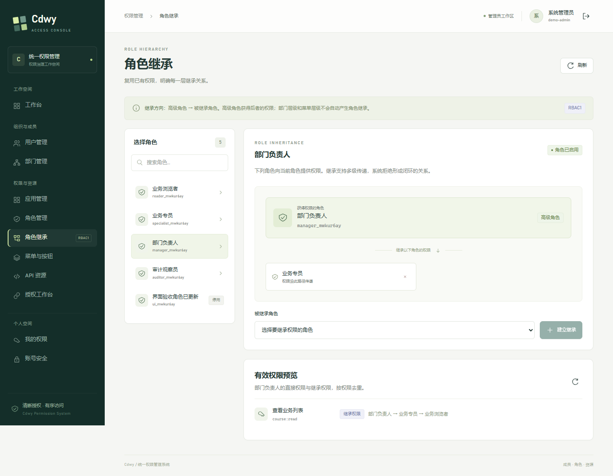

# 设计图与页面截图

当前版本共18张图，生成脚本为 `scripts/build-review-diagrams.py`。PNG/SVG 共用同一几何模型，类图检查框重叠、连线穿框、Service 中心性与源码方法；顺序图检查独立激活条和消息端点。字段引用以实线并标 role name；方法参数、局部与返回对象依赖使用虚线。图中只选场景相关成员，不虚构完整方法清单。

| 图 | PNG | SVG | 说明 |
|---|---|---|---|
| JWT 登录类图 | [PNG](images/class-auth.png) | [SVG](images/class-auth.svg) | AuthService、JWT、账号核验与密码编码器 |
| 前端权限与 API 类图 | [PNG](images/class-permission.png) | [SVG](images/class-permission.svg) | 菜单/按钮与独立资源的绑定 |
| RBAC1 类图 | [PNG](images/class-rbac1.png) | [SVG](images/class-rbac1.svg) | RoleHierarchyService、双角色引用、有效权限 |
| 登录成功顺序图 | [PNG](images/sequence-login.png) | [SVG](images/sequence-login.svg) | 查询、BCrypt、JWT、静态 UserViews 映射 |
| 请求鉴权顺序图 | [PNG](images/sequence-authorize.png) | [SVG](images/sequence-authorize.svg) | MVC 拦截器在业务控制器前认证与授权 |
| 错误密码顺序图 | [PNG](images/sequence-password-failure.png) | [SVG](images/sequence-password-failure.svg) | 异常从实际抛出方到 MVC，再映射401 |
| 建立继承顺序图 | [PNG](images/sequence-rbac1.png) | [SVG](images/sequence-rbac1.svg) | 图写锁、角色查询、防环与保存成功路径 |
| 六类核心概念 ER | [PNG](images/er-core.png) | [SVG](images/er-core.svg) | 三组授权与角色继承自关联，不持久化 JWT |
| 十一表物理 ER | [PNG](images/er-physical.png) | — | 2026-11-24 由组员重画（第二次检查版，见 [02-database-design.adoc](../second-review/02-database-design.adoc)）；[Mermaid源](physical-er.mmd) 为第一次检查时的版本 |

顺序图按场景省略构造和代理，内部调用者为 MVC 分发器，HTTP 响应由 MVC 序列化。核心 ER、物理 ER 使用各自建模语义，不套用 Service 布局规则。

## 重新生成与复核

```powershell
python scripts/build-review-diagrams.py
```

需要 Pillow 和中文字体。自动检查见 [diagram-validation.json](diagram-validation.json)，新增与变化 PNG 已打开检查，其余保留既有目视复核，记录见 [visual-review.json](phase-two/visual-review.json)。源码变化后仍需核对调用顺序与字段，自动通过不能替代目视检查。

## 当前界面

2026-11-22 起部署环境的首页是同组重构的权限台账：[总览页](phase-two/access-registry-overview.png)；各页面的浏览器验收见 `frontend-access-registry/tests`。下面是原管理控制台（仍在 `/ui/`）的截图与验收记录。

structured 与 ddd 各三组 Edge 场景在独立隔离 H2 库使用合成数据，共46项检查通过，无未捕获 JavaScript 异常。[业务记录](phase-two/ui-verification.json)、[前进后退记录](phase-two/navigation-verification.json)。

| 页面 | 截图 |
|---|---|
| 登录 | [查看](phase-two/login.png) |
| 工作台 | [查看](phase-two/overview.png) |
| 用户目录 | [查看](phase-two/users.png) |
| RBAC1 继承 | [查看](phase-two/hierarchy.png) |
| 三组授权 | [查看](phase-two/grants.png) |
| 个人权限与鉴权 | [查看](phase-two/my-permissions.png) |
| 390px 继承配置 | [查看](phase-two/mobile-hierarchy.png) |
| 390px 用户目录 | [查看](phase-two/mobile-users.png) |



此前第一次检查界面的 `images/ui-*.png` 与 `ui-verification.json` 保留历史用途，不作为本轮截图。当前截图不是服务器部署证据。

## 双实现与导入新增图

| 图 | PNG | SVG |
|---|---|---|
| RBAC1 双实现类图 | [PNG](images/class-dual-design.png) | [SVG](images/class-dual-design.svg) |
| 面向对象规则委派 | [PNG](images/sequence-ddd-policy.png) | [SVG](images/sequence-ddd-policy.svg) |
| 三表预览与确认导入 | [PNG](images/sequence-company-import.png) | [SVG](images/sequence-company-import.svg) |

结构化模式的[模块分解图 PNG](images/structure-rbac1.png) / [SVG](images/structure-rbac1.svg) 使用功能模块语义，独立于 UML 类图。

## 全业务双设计新增图

| 图 | PNG | SVG |
|---|---|---|
| 账号对象与用例 | [PNG](images/class-full-user.png) | [SVG](images/class-full-user.svg) |
| 领域仓储与JPA适配 | [PNG](images/class-domain-adapter.png) | [SVG](images/class-domain-adapter.svg) |
| 面向对象菜单/API绑定 | [PNG](images/class-ddd-permission.png) | [SVG](images/class-ddd-permission.svg) |
| 账号停用与凭证版本 | [PNG](images/sequence-ddd-account.png) | [SVG](images/sequence-ddd-account.svg) |
| 全业务结构化模块分解 | [PNG](images/structure-full-system.png) | [SVG](images/structure-full-system.svg) |

当前实现及源码路径以[全业务双设计](../phase-two/full-dual-design.md)为准。早期 AuthService/PermissionService/RoleHierarchyService 图表达结构化支线；DDD 当前使用 Ddd 服务及领域端口，不能把旧图中的 JPA 依赖算到领域对象上。[结构化浏览器证据](phase-two/full-dual-structured/browser-verification.json)、[面向对象证据](phase-two/full-dual-ddd/browser-verification.json)。
