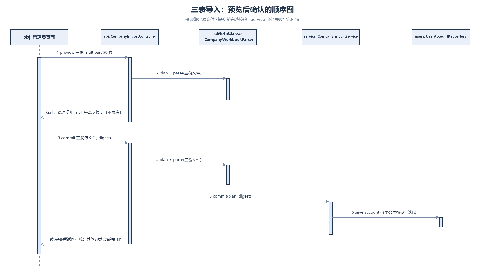

# RBAC1 双实现与公司三表导入

## 全业务双实现已补齐（2026-11-18）

当前 10 组业务用例均有结构化与面向对象实现，角色图算法另有双实现。最新模块、领域对象、仓储适配器、81 项测试和两模式浏览器验收见 [全业务双设计说明](full-dual-design.md)。下文保留三表导入业务规则及原表一致性核验依据。


## 三张原表的映射

| 来源 | 写入及保留 | 规则 |
|---|---|---|
| 员工信息表 | 用户、登录名、部门、分公司、原部门、岗位、电话 | 10,000 名员工；电话按字符串保留；项目部门简称按所属分公司补全，共 9,756 条，其中项目经理部简称 9,000 条 |
| 部门信息表 | 111 个部门、父子关系、经理名称 | 按完整部门名复用；验证缺失父级和环；经理文字不按同名员工猜测关联 |
| 功能权限清单 | 18 应用、115 模块、359 功能、操作按钮、5 类角色模板 | 应用目录→模块菜单→功能菜单→操作按钮；功能说明和五类原始单元格保留 |

原文件首张工作表实际为 `sheet2.xml`，并且 dimension 为 A1；解析器从 workbook relationship 定位首张工作表，读取真实 XML 行，不能依赖 dimension。支持原表“软件系统”以及界面示例“应用系统”列名。权限矩阵有 1 个空白单元格，预览明确提示并保持未授权；原值为空，不自动补成“无”或“全部”。合并单元格按应用／模块向下填充，新应用重置模块；不更改原文件。

清单中的 `view` 规范化为“查看”。“查看本人”“编辑本人”分别成为 `view_self`／`edit_self` 操作，不能直接赋予全量查看或编辑。“全部”只展开该功能在本清单明确出现的动作集合（至少查看），不预授未来操作。五类业务角色中“系统管理员”只是模板名称，不设置账号的 `administrator` 身份。

**本轮没有真实外部业务 API 方法和路径输入，因此不会生成虚构 API 或自动对接 18 个外部系统。** 本人范围的按钮保留了语义，外部业务 API 的行级过滤仍需在实际对接时实现。不会从岗位、部门经理姓名猜测个人授权，也不会从矩阵自动生成角色继承。


## 页面与接口

管理员导航“数据导入”分三步：选三张表→预览统计及规则→确认提交。更换任一文件会清除预览，禁止直接提交。`POST /api/imports/company/preview` 只校验、不落库；`POST /api/imports/company/commit` 再校验原文件和摘要并在一个事务写入。两者使用 multipart：`employees`、`departments`、`permissions`；commit 另外传 `digest`。未登录 401，普通员工 403，格式／摘要错误 400，已有管理员登录名冲突 409。

重复导入按用户名、部门名及稳定来源编码复用记录，已有账号的密码、启用状态与个人角色保留。导入角色模板在当前功能的动作范围内以最新矩阵同步，缩减授权时撤回旧模板授权；不会删除来源文件中整行已经消失的历史功能、员工或部门，需要管理员另行核实处理。来源模板应作为清单管理对象，避免手工修改后又被下一轮清单覆盖。

新员工账号先停用，无可用初始密码。用户列表可展开来源资料并点击“设置密码”，随后单独启用、按职责分配角色。对未初始化的员工不发放公共初始密码。权限清单仅导入到目录，不自动使真实业务接口可访问。




## 可持久保存的运行方式

默认运行仍为隔离 H2 内存环境。公司数据实例使用 [启动脚本](../../scripts/start-company-console.ps1) 创建独立 H2 文件库；首次 `create`，已有文件则 `validate`，不重建、不覆盖库。签名密钥与随机管理员凭据位于私有运行目录的 `access.local.json`，不写入源码或公开文档。

```powershell
# 先将 JAVA_HOME 设置为自己的 JDK 21 安装目录
.\scripts\start-company-console.ps1 -Strategy structured -Port 18083 -RuntimeDirectory .\work\company-runtime
# 使用同一运行目录切换面向对象模式，数据保持不变
.\scripts\start-company-console.ps1 -Strategy ddd -Port 18083 -RuntimeDirectory .\work\company-runtime
```

地址 `http://127.0.0.1:18083/ui/index.html`。管理员工作区页头从 `GET /api/system-info` 读取实际模式。脚本只停止该运行目录中自己记录且命令行匹配的进程，不停止其他服务。端口被其他程序占用时应先核查；文件数据库不允许被两个实例同时打开。

文件 H2 验证不能视为真实 MySQL 验证。MySQL 提供 [新库DDL](../first-review/database-mysql.sql) 与 [来源字段增量脚本](migrate-company-source-fields.sql)，没有连接服务器或替换旧业务数据库。


## 原表一致性核对

在关闭文件库实例后用独立 JDBC 只读查询，将员工来源字段、部门父级与经理、功能说明与原始权限矩阵、操作按钮、角色操作授权分别排序计算 SHA-256；预期由 Python/openpyxl 独立读取原表推导。五类的数量与摘要全部一致：员工 10,000、部门 111、功能 359、按钮 797、角色操作关联 2,192。查询不输出员工明细。导入后用户共 10,001（含独立初始化管理员），权限节点 1,271（菜单 474、按钮 797）；个人角色、继承关系、API 资源与 API 绑定均为 0。
