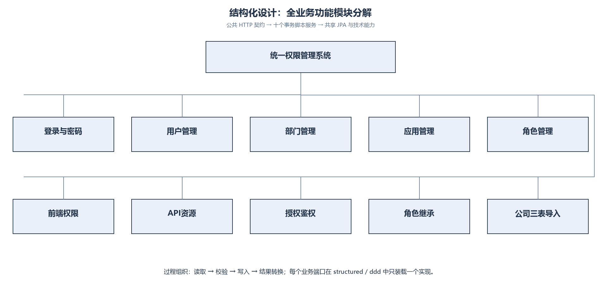
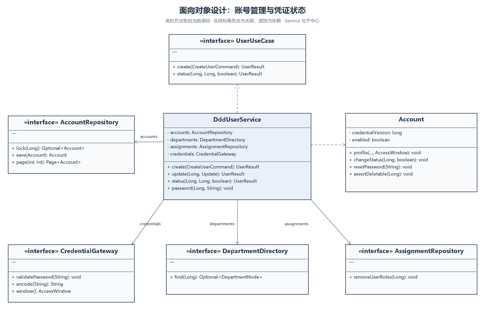
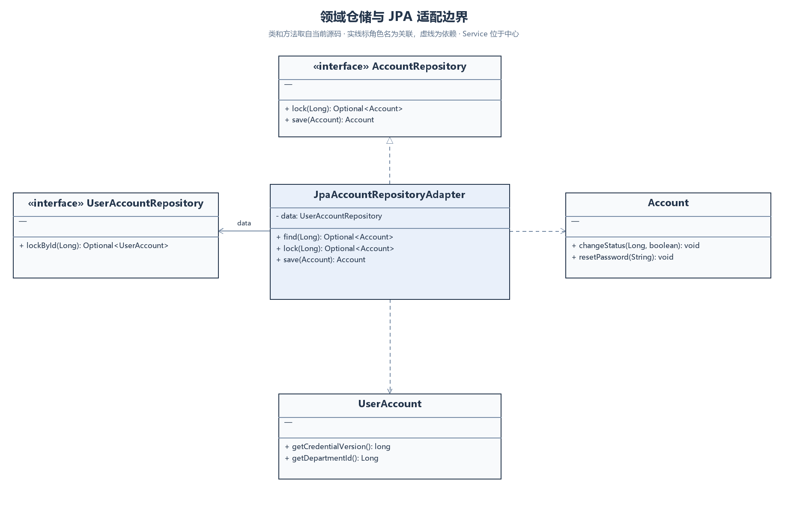
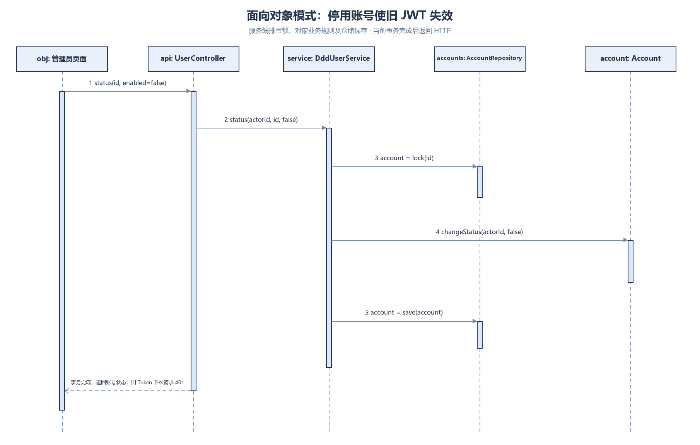
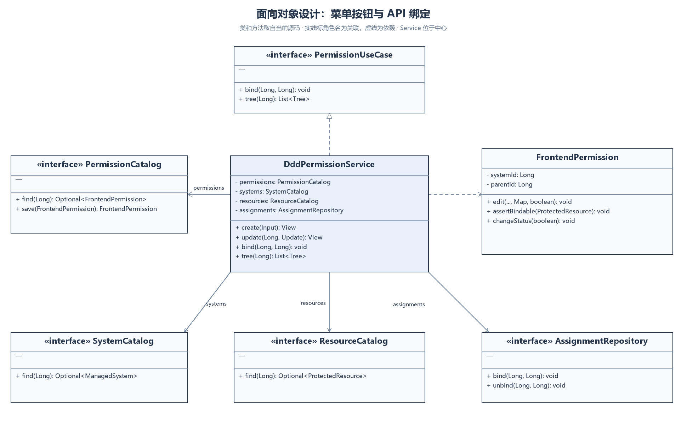

# 全业务双设计与实现说明

小组：Cdwy。更新日期：2026-11-18。适用版本：本次检查版本，基于第一次检查整改的六类核心概念、11 张表与 56 个 HTTP 操作。

## 1. 本次补齐的范围

原版本只有 RBAC1 角色图核心提供两种算法实现，其他 CRUD、鉴权及导入共用事务脚本。本次已将当前产品的 **10 组业务用例** 全部接入统一端口，分别提供结构化与面向对象实现；角色图算法另有一组双实现。前端、HTTP 契约、物理数据库、文件格式解析与加密技术能力共用。

本次没有新增业务需求、额外业务系统或微服务；没有把 18 个应用名称当成 18 个已经对接的外部系统。全业务双实现指当前范围内已有行为，不包含尚未开发的审批、SSO、数据行级过滤、互斥角色和真实外部系统联调。

## 2. 学习老师仓库的依据与适配

参考仓库：`https://gitee.com/mingqcn/course-project-mgt/`，本次再次核对远端 HEAD 为 `ca90f1cb7faa7d73b71b93a125460513f46b730e`。

主要阅读 `docs/backend-design.md`、`service/structured/term/StructuredTermService.java` 与 `service/ddd/application/term/DddTermService.java`。老师项目的学期管理通过相同 UseCase 端口对外，`@ConditionalOnProperty` 按 `app.backend-strategy` 选择 structured 或 ddd，DDD 应用服务协调领域对象及领域仓储，不直接依赖 JPA。

| 老师方案 | 本系统的落实 | 本系统适配 |
|---|---|---|
| 一套 Controller + UseCase | 全部业务控制器注入 `service/port` 中的接口 | 不复制课程、学生、教师模型 |
| structured 事务脚本 | 原 `service/user`、`organization`、`system` 等服务加条件装配 | 保留原源码位置便于教师比较 |
| ddd 应用服务 | `service/ddd/application` 十个业务服务 | 只依赖领域对象、仓储端口与技术端口 |
| 有行为的领域对象 | Account、DepartmentNode、ManagedSystem、AccessRole、FrontendPermission、ProtectedResource 等 | 保留本系统身份期限、JWT、来源资料与 RBAC1 规则 |
| JPA 适配器 | `infrastructure/persistence` 七个适配器 | 保持原 11 表结构与已有数据 |
| 认证等基础设施共享 | CredentialGateway、ResourcePathMatcher 与文件解析器 | 保留本地账号 + BCrypt + JWT，不引入来源项目 SSO |
| 相同行为验收 | 同一组 HTTP 测试在两种模式下重跑 | 不以两个空壳类冒充两种设计 |

## 3. 十个业务模块逐项对照

以下源码均位于 `src/main/java/com/cdwy/permission`。

| 模块 | 共用用例端口 | 结构化实现 | 面向对象实现 | 领域行为或约束 |
|---|---|---|---|---|
| 登录与本人改密 | AuthenticationUseCase | [AuthService](../../src/main/java/com/cdwy/permission/service/auth/AuthService.java) | service/ddd/application/auth/DddAuthenticationService | Account.usable；凭证版本校验；原密码验证后更新 |
| 用户 | UserUseCase | [UserService](../../src/main/java/com/cdwy/permission/service/user/UserService.java) | service/ddd/application/user/DddUserService | Account.profile/changeStatus/resetPassword/assertDeletable；AccessWindow 期限 |
| 部门 | DepartmentUseCase | [DepartmentService](../../src/main/java/com/cdwy/permission/service/organization/DepartmentService.java) | service/ddd/application/organization/DddDepartmentService | DepartmentNode.relocate 防环；引用删除保护 |
| 应用 | SystemUseCase | [SystemService](../../src/main/java/com/cdwy/permission/service/system/SystemService.java) | service/ddd/application/system/DddSystemService | ManagedSystem 的资料、状态与引用保护 |
| 角色 | RoleUseCase | [RoleService](../../src/main/java/com/cdwy/permission/service/role/RoleService.java) | service/ddd/application/role/DddRoleService | AccessRole 状态、资料、授权及继承引用保护 |
| 菜单按钮与绑定 | PermissionUseCase | [PermissionService](../../src/main/java/com/cdwy/permission/service/permission/PermissionService.java) | service/ddd/application/permission/DddPermissionService | FrontendPermission.edit/assertBindable；PermissionDirectory 导航与授权区分 |
| API 资源 | ResourceUseCase | [ApiResourceService](../../src/main/java/com/cdwy/permission/service/resource/ApiResourceService.java) | service/ddd/application/resource/DddResourceService | ProtectedResource 路径、状态与绑定引用保护 |
| 授权及请求鉴权 | AuthorizationUseCase | [AuthorizationService](../../src/main/java/com/cdwy/permission/service/rbac/AuthorizationService.java) | service/ddd/application/rbac/DddAuthorizationService | AuthorizationSnapshot 合并有效权限、来源、路径；API 最具体匹配 |
| 角色继承维护 | HierarchyUseCase | [RoleHierarchyService](../../src/main/java/com/cdwy/permission/service/rbac/RoleHierarchyService.java) | service/ddd/application/rbac/DddHierarchyService | RoleGraph 防环；事务图锁；显式边幂等 |
| 员工信息同步 | DirectorySyncUseCase | [DirectorySyncService](../../src/main/java/com/cdwy/permission/service/directory/DirectorySyncService.java) | service/ddd/application/directory/DddDirectorySyncService | EmployeeDirectory 建立“分公司 / 部门”两级树、按工号幂等合并人员并补授角色；Account 拒绝覆盖管理员 |

角色图算法端口 `RoleGraphUseCase` 由 `StructuredRoleGraphService` 或 `DddRoleGraphService` 实现。继承维护属于上述业务模块，算法端口是其内部协作，不额外计算成一个产品模块。

## 4. 结构化设计怎样工作

流程式服务按“读取数据 → 验证业务条件 → 写入状态和关系 → 生成结果”组织用例，直接操作 JPA Repository 和受管 Entity。事务放在业务服务上。角色继承算法用队列和集合按过程维护遍历状态。



例如 `UserService.status`：锁定账号 → 检查本人和管理员保护 → 比较启用状态 → 必要时递增凭证版本 → 返回结果。数据主要由服务处理，账号实体承担持久化映射。

## 5. 面向对象设计怎样工作

调用链为：Controller → UseCase → DDD 应用服务 → 领域对象/领域仓储端口 → JPA Adapter → Spring Data Repository → 数据库。

Controller 先通过 DTO/Bean Validation 校验格式，再由 `HttpMapping` 映射为 Command；应用服务加载对象、组织事务和跨对象一致性；对象维护自身规则；基础设施适配器负责实体与领域状态转换。返回结果通过 `HttpMapping` 转成原 VO/只读视图，浏览器收到的 JSON 字段保持兼容。




**例：停用账号。** `DddUserService.status` 通过 AccountRepository.lock 取得账号 → 调用 Account.changeStatus → 对象拒绝停用本人或管理员、重复请求不重复增加版本 → 仓储保存 → 事务完成。下一次使用旧 JWT 请求时，认证服务重新比较当前 credentialVersion，返回 401。



**例：菜单与 API 绑定。** `DddPermissionService.bind` 加载 FrontendPermission 与 ProtectedResource，调用权限对象的 assertBindable 拒绝跨应用绑定，随后 AssignmentRepository 保存关联。菜单导航为补全祖先显示为容器，不自动授予祖先对应 API 的访问权限。



**例：员工信息同步。** `EmployeeSheetReader` 共用文件格式解析与逐行校验，输出与持久化无关的数据行和文件摘要值。DDD 应用服务在一个事务中加载领域目录，由 `EmployeeDirectory` 计算部门、人员与角色授权的变化；确认时先核对文件与规则的摘要和预览一致，`Account` 只更新资料、保留密码与启用状态，并拒绝覆盖管理员。发生中途冲突，之前写入全部回滚。

## 6. 数据库与映射边界

业务模型没有新增表。两种模式仍使用六类核心概念、10 个 JPA Entity、11 张表、14 个外键。UserAccount 的资料/账号二级表仍分别是 sys_user/sys_account。

七个领域仓储端口分别为 AccountRepository、DepartmentDirectory、SystemCatalog、RoleCatalog、PermissionCatalog、ResourceCatalog、AssignmentRepository。对应 JPA 适配器将关联转换为业务 ID，显式转换人员类型和权限类型；DDD 应用/领域不得导入 JPA Entity、JpaRepository、Spring Data Repository 或基础设施实现。

同名同类型的可变对象映射使用 CloneFactory；枚举、关系、派生字段显式转换；不可变 record 使用构造函数。已检查编译生成的映射与 HTTP 返回，来源公司、部门、岗位、电话、经理、功能说明与原矩阵字段保持往返。布尔访问器使用本项目 CloneFactory 所需的 get 约定。

唯一约束需在适配器事务内转译时使用 saveAndFlush；其余事务原子性由应用服务控制。测试与部署都在 MySQL 上以 validate 运行。全量授权快照及批量导入尚未作大规模性能压测，不承诺生产 SLA。

## 7. 运行与切换

先配置 JDK21，运行 `scripts/build-first-review.ps1`（首次环境会安装仓库附带 CloneFactory），或在依赖已经可用时运行 Maven verify。

```powershell
# 使用同一个运行目录切换模式：只变实现，不重建已有数据库
.\scripts\start-company-console.ps1 -Strategy structured -Port 18083 -RuntimeDirectory .\work\company-runtime
.\scripts\start-company-console.ps1 -Strategy ddd -Port 18083 -RuntimeDirectory .\work\company-runtime
```

实际使用应沿用正在使用的 RuntimeDirectory；当前已有数据的运行目录由操作人保存，不复制私有凭据到 Git。`-RuntimeDirectory` 为同一目录时，两模式读取相同文件库；已存在库使用 validate。端口不同而打开相同文件库也不支持并发运行。

管理员调用 `GET /api/system-info`，返回 backendStrategy、authorizationModel 和 modules。modules 十个条目的值来自实际注入的业务端口，不是前端硬编码。前端页头显示配置选中的实际模式。

24 个 `@Service` 定义中，11 对按条件二选一，再加 JWT 和首次管理员初始化两个共享技术服务，每个模式实际装载 13 个。Adapter 使用 `@Repository`/`@Component`，不混入 Service 数量。Spring 条件装配在启动时选择，页面没有热切换数据库行为。

## 8. 可复核验收

全部后端测试连接真实 MySQL，每个测试在事务内执行并回滚；`Ddd*` 测试类继承结构化测试类，同一组测试方法在两条设计路线上各跑一遍。按需求编号整理的测试清单、错误码契约与运行方法见[需求—测试追踪](../second-review/04-test-traceability.adoc)。

2026-11-21：186 个后端测试，失败 0、错误 0、跳过 0；53 个业务错误码全部有契约测试；JaCoCo 指令 93.6%、分支 84.0%、行 94.0%、方法 92.0%（含 CloneFactory 生成代码）。前端 5 组浏览器测试与课程系统跨系统联调在两种模式下各自通过。汇总见 [verification.json](../first-review/verification.json)。

## 9. 教师检查建议路径

1. 读本页第 3 节，按模块找到同一端口的两种实现。
2. 以 UserController 为入口，确认 `UserCreateDTO` 的格式校验、`UserVoMapper` 的 DTO → Command 与 Result → VO 映射，以及 UserUseCase 调用边界。
3. 比较 UserService.status 与 DddUserService.status，再打开 Account.changeStatus。
4. 打开 AccountRepository 与 JpaAccountRepositoryAdapter，追踪到 UserAccountRepository 和 11 表物理 ER。
5. 比较 PermissionService.bind 与 DddPermissionService.bind，观察对象如何维护跨应用约束。
6. 查看 AuthorizationSnapshot、RoleGraph，解释多级/菱形继承、停用阻断、来源及实时撤权。
7. 查看 DddDirectorySyncTests 的继承测试，说明表中出现管理员账号时为何整批回滚；员工信息表与运行凭据不属于公开仓库交付内容。

本次是可切换的单体双设计实现，不是两个独立部署系统；API、数据库及技术适配器的复用是设计选择。两种模式都已在服务器的 Docker Swarm 上以 MySQL 部署运行；旧库迁移与生产规模性能测试不在本轮范围。

公司数据工作区已以 ddd、validate 启动，只读核对原有 10,001 个账号仍在，十个业务模块均报告 ddd；未重新导入或批量修改来源数据。见[只读复核](../design/phase-two/full-dual-company-readonly.json)。
